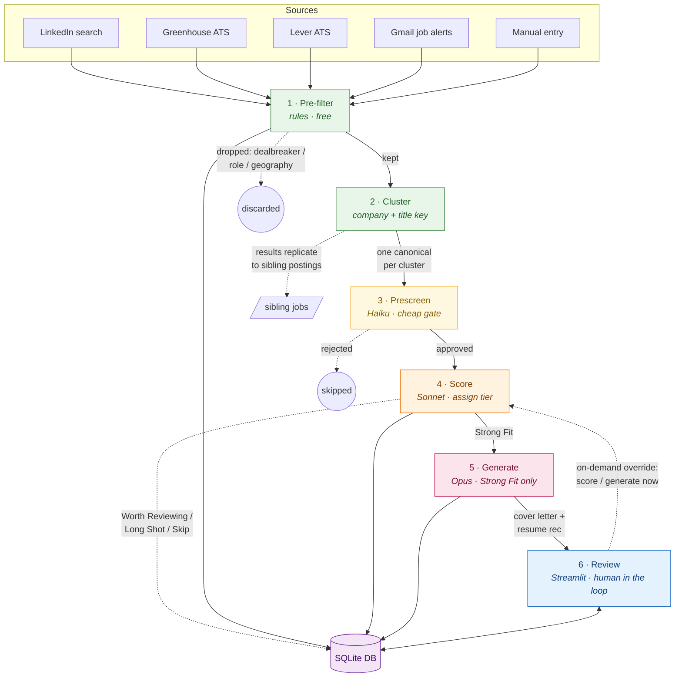

# Job Search Pipeline — Quick Reference

*A conceptual overview for someone new to the project. This explains **what it does and how it works**, not how to operate it — see `README.md` for commands and setup.*

---

## The concept in one paragraph

This is an agentic pipeline that automates the top of a job-search funnel. It continuously
**discovers** job postings from multiple sources, **filters and scores** them against one
person's profile using LLMs, and for the best matches **generates tailored application
materials** (a cover letter and a resume-tweak recommendation). A human then reviews the
results in a web UI, tracks which jobs they've applied to, and can trigger scoring or
generation on demand. The design goal is to spend expensive LLM calls only where they add
value — cheap filters weed out obvious non-matches first, and near-duplicate postings are
collapsed so each real opportunity is evaluated once.

---

## The funnel

The pipeline is a cost-descending funnel: each stage is more expensive per job than the
last, so each stage tries to pass as few jobs as possible to the next.

```
   SOURCES                     A stage's job is to
 ┌──────────────────┐          shrink the pool cheaply
 │ LinkedIn search  │          before the pool hits a
 │ Greenhouse ATS   │          more expensive stage.
 │ Lever ATS        │
 │ Gmail job alerts │
 │ Manual entry     │
 └────────┬─────────┘
          │  raw postings
          ▼
 ┌──────────────────────────────┐   Rule-based, FREE.
 │ 1. PRE-FILTER                │   Drops on dealbreaker keywords,
 │    (rules, no LLM)           │   wrong role type, or location
 └────────┬─────────────────────┘   outside target geography.
          │  kept postings → saved to DB
          ▼
 ┌──────────────────────────────┐   Collapses near-duplicate postings
 │ 2. CLUSTER                   │   (same role broadcast across many
 │    (company + title key)     │   cities) into ONE canonical job.
 └────────┬─────────────────────┘   Siblings inherit results later.
          │  one canonical per cluster
          ▼
 ┌──────────────────────────────┐   Haiku (cheapest LLM). A fast
 │ 3. PRESCREEN                 │   yes/no gate. Rejects obvious
 │    (Haiku)                   │   non-fits before real scoring.
 └────────┬─────────────────────┘
          │  approved jobs
          ▼
 ┌──────────────────────────────┐   Sonnet. Assigns a fit TIER +
 │ 4. SCORE                     │   skill/preference scores, gaps,
 │    (Sonnet)                  │   positioning notes, rationale.
 └────────┬─────────────────────┘   Tiers: Strong Fit / Worth
          │  scored jobs            Reviewing / Long Shot / Skip.
          ▼
 ┌──────────────────────────────┐   Opus (most expensive). Runs
 │ 5. GENERATE                  │   only for Strong Fit by default.
 │    (Opus)                    │   Produces cover letter +
 └────────┬─────────────────────┘   resume recommendation.
          │  application materials
          ▼
 ┌──────────────────────────────┐   Human reviews, edits, applies,
 │ 6. REVIEW (Streamlit UI)     │   and tracks outcome. Can override
 │    (human in the loop)       │   filters / score / generate on demand.
 └──────────────────────────────┘
```

Once a stage's result is computed for the canonical job in a cluster, it is **replicated**
onto all the sibling postings for free — so the UI and queries treat each city's posting as
scored, but the LLM only paid once.

### Rendered flow



*Solid arrows are the happy path; dashed arrows are exits, replication, and human overrides.
Node colours track cost, from free (green) → Haiku (yellow) → Sonnet (orange) → Opus (pink).*

---

## Key ideas that make it work

**Clustering (dedupe by opportunity, not by posting).** The same role is often posted across
4–6 cities with distinct IDs. A `cluster_key` derived from *company + title* (deliberately
ignoring location) groups them. The pipeline picks one "canonical" posting per cluster —
preferring the best-located variant — scores/generates for it once, and copies the outcome to
its siblings. This is the single biggest cost saver.

**Cheapest-model-first gating.** Rules → Haiku → Sonnet → Opus. Each layer removes work from
the more expensive layer above it. Opus (materials generation) only ever sees a small,
pre-vetted slice of the original pool.

**Batch API by default.** Prescreening and scoring submit their LLM calls through Anthropic's
Batches API, which is ~50% cheaper than synchronous calls (at the cost of latency — results
may take minutes). Synchronous fallback exists for the UI's on-demand "score/generate now"
buttons and when a batch errors or times out.

**Profile-driven.** One person's preferences live in `profile/` — a YAML of target companies,
dealbreakers, geography, and scoring rubric, plus supporting docs (resume versions, narrative
guidance, voice examples, accomplishments). The prompts template themselves from this profile,
so the pipeline's judgment is entirely configurable without code changes.

**Human-in-the-loop.** Nothing is auto-submitted anywhere. The pipeline produces *drafts and
recommendations*; a person reviews them in the Streamlit UI, tracks application status, and can
override any automated decision (e.g. re-score a job the prescreen rejected).

---

## Data model (SQLite)

A single SQLite database is the shared state between the CLI pipeline and the UI.

| Table | Represents |
|---|---|
| **User** | The profile owner (this build is single-user, but keyed for multi-user). |
| **Job** | One posting: source, company, title, location, URL, JD text, `status` (active / expired / closed). |
| **Score** | An LLM scoring result for a job: tier, sub-scores, gaps, positioning, rationale. |
| **Application** | A generated application: points at the folder of materials on disk. |
| **UserJobMeta** | Per-job/user state: prescreen decision and application tracking status (applied / interviewing / offer / rejected). |

Generated materials are written to disk under `outputs/{user}/{date}_{company}_{role}/`
(`cover_letter.md`, `resume_recommendation.md`, `score.json`, `job.md`), while the DB tracks
where they live and what state each application is in.

---

## The two entry points

Both call the **same** pipeline code in `src/job_agent/pipeline.py`:

- **CLI (`job-agent`)** — runs the batch pipeline: `discover → prescreen → score → generate`,
  plus housekeeping (sweep stale postings, prune closed LinkedIn jobs). This is the
  scheduled/bulk path.
- **Streamlit UI** — the human review surface: browse and filter all jobs, read scores and
  drafts, track outcomes, and trigger single-job score/generate synchronously.

---

## Housekeeping

Postings don't stay open forever, so two maintenance passes keep the pool honest:

- **Sweep** — flips jobs not re-seen within N days to `expired`.
- **Prune closed** — checks active LinkedIn postings for a "no longer accepting applications"
  notice and flips those to `closed`.

Only `active` jobs flow through scoring, generation, and the UI.

---

## Repo orientation

| Path | What lives there |
|---|---|
| `src/job_agent/pipeline.py` | Orchestration — the glue for every stage above. |
| `src/job_agent/discovery/` | One module per source (LinkedIn, Greenhouse, Lever, email, manual). |
| `src/job_agent/filter.py` | The free rule-based pre-filter. |
| `src/job_agent/clustering.py` | Cluster-key derivation and canonical selection. |
| `src/job_agent/scoring/` | Prescreen (Haiku) + score (Sonnet) prompts and logic. |
| `src/job_agent/generation/` | Cover letter + resume recommendation (Opus). |
| `src/job_agent/batches.py` | Anthropic Batches API submit/poll/collect helpers. |
| `src/job_agent/db.py` | SQLModel schema + session helpers. |
| `app/streamlit_app.py` | The review UI. |
| `profile/` | The person's config, rubric, and source documents (gitignored). |
| `outputs/` | Generated application materials (gitignored). |
```
