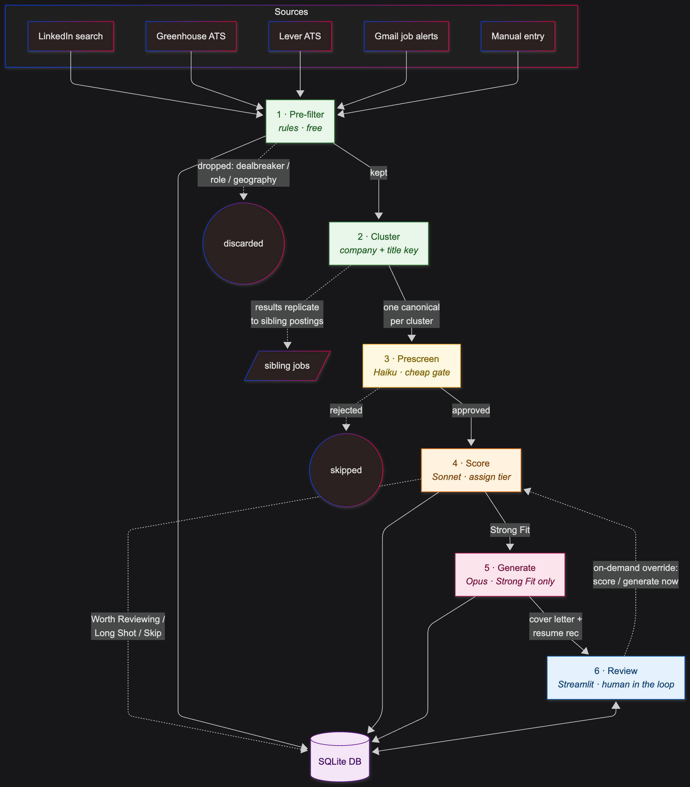

# Job Search Pipeline

Agentic pipeline for job discovery, fit scoring, and application-material generation. The job search is a funnel — finding postings, reading them, scoring fit, drafting letters — and most of it is toil. This automates the toil. The judgment stays human: nothing submits an application.

## How it works

**Discover.** Pulls postings from LinkedIn, Greenhouse / Lever / Ashby / Workday ATS APIs, Gmail job alerts, and manual adds. Deterministic rule pre-filters drop obvious non-fits before any LLM call is spent.

**Prescreen.** Haiku does a cheap binary fit check on everything that survives the filters.

**Score.** Sonnet scores fit structurally — skill fit, preference alignment, gaps, positioning notes — into tiers: Strong Fit, Worth Reviewing, Long Shot, Skip. Runs through the Batches API at a 50% discount.

**Generate.** On demand, per job: cover letter (Opus), resume recommendations, application-form answers, and a grounding check that verifies every claim in the letter against your materials. Generation is on-demand because the Opus calls are the expensive part — no point drafting letters for jobs you'll never touch.



Every application lands in `outputs/<user>/{date}_{company}_{role}/`:

| File | Contents |
|---|---|
| `job.md` | Source, URL, scores, JD preview — the quick-glance summary |
| `cover_letter.md` | Draft letter; edit, then paste |
| `resume_recommendation.md` | Which resume version to use + surgical text edits |
| `answers.md` | Pre-drafted application-form answers; `TODO` where the profile can't answer |
| `grounding_check.md` | Claim-by-claim verification of the letter against your materials; `REVIEW` flags for human eyes |
| `score.json` | Tier, scores, rationale, gaps, positioning notes |

## Resume tailoring

`job-agent tailor-resume` applies a `resume_recommendation.md` to a copy of your base resume PPTX — text swaps and in-section bullet reorders, formatting preserved — and flags anything that might have overflowed its text frame (exit code 2). It removes the mechanical toil, not the review pass.

Two layers, kept in sync: the `.md` files under `profile/resume_versions/` are the text layer the LLM reads (with character budgets so suggestions stay layout-safe); the PPTX is the layout layer. `job-agent doctor` verifies the two match.

## Quickstart

Prerequisites: Docker and an Anthropic API key.

```bash
git clone https://github.com/theokelly/job-search-pipeline.git
cd job-search-pipeline
cp .env.example .env                          # add your ANTHROPIC_API_KEY
cp profile_template/example.yaml profile/theo.yaml   # your profile (gitignored)
docker compose build
docker compose run --rm --service-ports dev
```

The container builds a venv and installs dependencies on first start. Inside it:

```bash
job-agent run --linkedin --email-days 14   # discover new jobs, score the unscored
job-agent generate                         # materials for Strong Fit jobs
job-agent tailor-resume outputs/<user>/<date>_<company>_<role>
job-agent doctor                            # health check: profile, env, file sync
```

Prefer a UI? `bash run_ui.sh` starts Streamlit at http://localhost:8501 — review scores, generate materials per job, and tailor resumes from the browser.

## The profile

Everything personal lives in gitignored `profile/`: resume versions, STAR stories, cover-letter principles, target roles and geography, scoring preferences, and vetted application answers. `profile_template/example.yaml` documents the full schema — copy it and fill in your own. (It was generated from a real profile by `scripts/build_profile_template.py`, which redacts identity, secrets, and personal answers; re-run it after changing your profile.)

## Cost

Measured costs with batching:

| Operation | Model | Est. cost |
|---|---|
| Prescreen 1 job | Haiku | ~$0.0005 |
| Score 1 job | Sonnet | ~$0.005 |
| Cover letter (Strong Fit) | Opus | ~$0.07 |
| Cover letter (Worth Reviewing) | Sonnet | ~$0.04 |
| Answers + grounding check | Haiku | ~$0.01 |

Materials generate for Strong Fit only by default; Worth Reviewing letters are per-job from the UI. That cuts generation volume ~8x.

## Design notes

- **Human in the loop.** The pipeline drafts; you review, edit, and submit. End-to-end automation is deliberately off the table.
- **Batches API for scoring.** 50% cheaper than synchronous calls. Prompt-cache hits inside a batch are best-effort (concurrent requests usually miss), so the discount — not caching — is the real saving.
- **Drive as source of truth (optional).** STAR stories and brag sheet can sync from Google Docs; generation auto-syncs with a 15-minute staleness guard and never breaks when Drive is unreachable.

`OVERVIEW.md` has the architecture quick reference.

## License

MIT — see [LICENSE](LICENSE).
